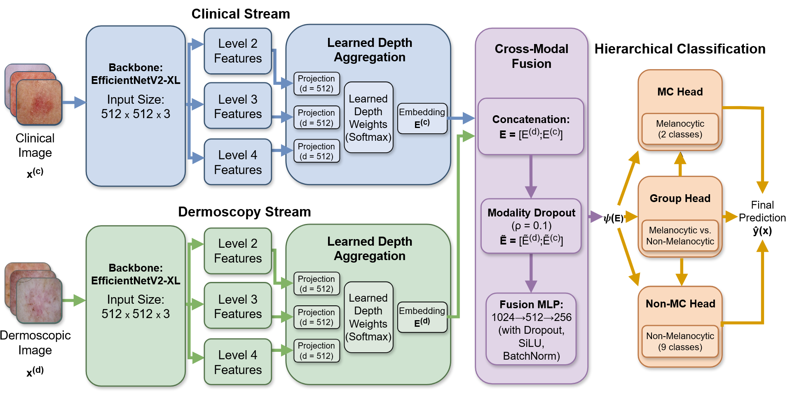

# DermaNet

**Flexible-View Fusion for Dermoscopic–Clinical Skin Lesion Classification**  
*11th Workshop on Skin Image Analysis (ISIC), MICCAI 2026*

<p align="center">
  
</p>

**Paper:** [Open-access PDF](https://papers.miccai.org/miccai-2026-sat/paper/ISIC_018.pdf) · **Review:** [OpenReview](https://openreview.net/forum?id=xDP0Va0g8E)

**Authors:** Anil Tan Aktan, Mehmet Umut Şen, Erchan Aptoula, Berrin Yanıkoğlu  
**Affiliation:** Sabancı University, Türkiye

## Overview

DermaNet is a deep learning framework for skin lesion classification that combines dermoscopic and clinical imagery while supporting inference with **paired or single-view inputs**. It integrates multi-level feature learning, clinically informed hierarchical prediction, and flexible-view fusion in a unified architecture.

### Key components

- **Modality-specific encoders:** Separate EfficientNetV2-XL backbones process dermoscopic and clinical images.
- **Multi-level feature aggregation:** Learned weights combine features from backbone levels 2, 3, and 4.
- **Feature-level fusion:** View-specific embeddings are fused into a shared representation for classification.
- **Modality dropout:** Training with randomly masked views supports inference when one modality is unavailable.
- **Hierarchical classification:** Melanocytic/non-melanocytic group prediction and group-specific classification heads, with hard or soft probability routing.

## Results

| Dataset | Metric | Result |
| --- | --- | ---: |
| MILK10k | Macro-F1 | **49.7%** (baseline: 40.3%) |
| ISIC2019 | Micro-F1, official test set | **77.42%** |

The full DermaNet architecture increases the model parameter count by **only 0.4%** relative to the baseline. For evaluation details and ablations, see the [paper](https://papers.miccai.org/miccai-2026-sat/paper/ISIC_018.pdf).

## Repository structure

```text
configs/                  Training configurations
src/data/                 Data loading and image transformations
src/models/               DermaNet, aggregation, fusion, hierarchy, modality dropout
src/training/             Training pipeline
src/evaluation/           Evaluation metrics and test-time augmentation
scripts/train_milk10k.py  Model training entry point
scripts/infer_milk10k.py  Inference from a saved checkpoint
docs/                     Architecture figure
```

## Installation

Install the Python dependencies:

```bash
pip install -r requirements.txt
```

## Training

Set your dataset paths and training options in `configs/milk10k_reference.yaml`, then run:

```bash
python scripts/train_milk10k.py --config configs/milk10k_reference.yaml
```

The best checkpoint is selected using validation Macro-F1.

## Inference

After training, run inference with a saved checkpoint:

```bash
python scripts/infer_milk10k.py \
  --config configs/milk10k_reference.yaml \
  --checkpoint checkpoints/best_milk10k.pth \
  --input-root path/to/test/images \
  --output outputs/predictions.csv
```

## Data availability

This repository does not include datasets, private labels, challenge files, trained checkpoints, or submission files. Obtain the required datasets from their original providers and configure the local dataset paths before training or inference.

## Citation

If you use DermaNet in your work, please cite:

```bibtex
@InProceedings{AktAni_DermaNet_MICCAISAT2026,
  author    = {Aktan, Anil Tan and Sen, Mehmet Umut and Aptoula, Erchan and Yanikoglu, Berrin},
  title     = {{DermaNet: Flexible-View Fusion for Dermoscopic--Clinical Skin Lesion Classification}},
  booktitle = {Medical Image Computing and Computer Assisted Intervention -- MICCAI 2026 Workshops and Challenges},
  series    = {Lecture Notes in Computer Science},
  volume    = {17271},
  publisher = {Springer Nature Switzerland},
  year      = {2026},
  url       = {https://papers.miccai.org/miccai-2026-sat/ISIC_018.html}
}
```
